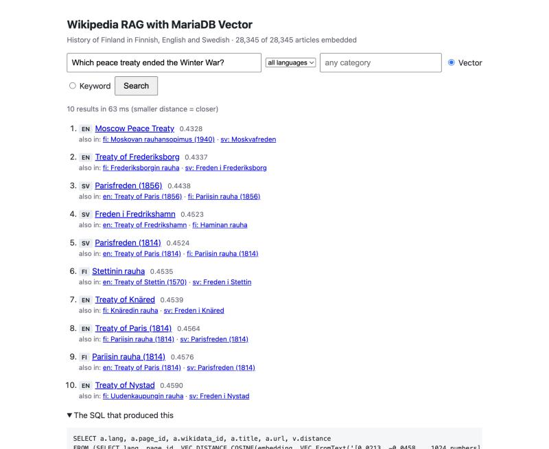

# Wikipedia RAG with MariaDB Vector

> **Status:** steps 1–6 work, and step 8 is partly done: retrieval is measured against 32 test
> questions, the vector index is tuned, and search can be limited to a category. Still to do:
> hybrid search, chunks, and *Ask* (step 7). Anything marked **(to verify)** is not checked yet.
>
> **Developed against MariaDB 12.2.2** (Homebrew, macOS). Vector search needs 11.7 or later;
> `docker-compose.yml` uses `mariadb:lts`.

Ask a question in English, Finnish or Swedish and find the Wikipedia articles that answer it —
even when the answer is only written in another language. Then let an AI model write a short
answer that cites those articles.

Everything runs on a laptop: MariaDB stores the articles **and** their vectors in the same
database, and one SQL statement does the semantic search. No separate vector database.



Built for the [Junction 2026](https://www.hackjunction.com/) challenge *Wikipedia Through Time*,
as the example for the RAG track. The data is the *History of Finland* set (dataset **S**):
28,345 articles: 18,859 Finnish, and the 4,904 English and 4,582 Swedish articles on the same
topics. 2,615 topics exist in all three languages.

## What we found

- **Cross-language search works.** 32 test questions in Finnish, Swedish and English: the right
  article is in the top 5 for 81%, in the top 10 for 94%. Ordinary keyword search: 19% and 44%.
  Questions whose answer exists *only in Finnish* were found at rank 1 even when asked in English
  or Swedish.
- **The default vector index settings were not good enough.** With MariaDB's defaults (`M=6`,
  `mhnsw_ef_search=20`) the index found only 79% of the true 10 nearest articles, and for some
  questions none. With `M=16` and `ef_search=80`: 100%, in ~5 ms.
- **How you write the SQL decides whether the index is used.** The obvious query — vectors joined
  to articles, `ORDER BY distance LIMIT 10` — read 22,000 rows and took 50 ms. The same search in
  a subquery, joined afterwards, used the index: 1 ms.
- **Vector search and SQL filters combine in one statement.** A category and all its
  subcategories (a recursive query over the category tree) plus the vector ranking: exact results,
  10 ms for a small category — but 2 s for one that holds every article, because MariaDB then
  compares them all instead of using the index.
- **One vector per article finds the topic, not the fact.** *"Who led Finland in the Winter War"*
  finds the Winter War, not its leaders.

Details and how each was measured: step 8 and *Numbers*.

## Why inside MariaDB, and not a separate vector database

- **One statement does both.** Ranking by meaning and filtering by language, category or date is
  one SQL query with joins — not a vector search in one system, then a filter in another, then
  stitching the two together in code.
- **Nothing to keep in sync.** The vector sits in a row next to the article's id. Insert, update
  and delete are transactions; there is no second store that can fall behind or disagree.
- **The database tracks the work.** "Has a row in `article_vector`" = "is embedded", so the
  embedding job can stop and restart at any time (step 2). Search runs at the same time on
  whatever is committed, because MariaDB supports concurrent reads and writes on a vector index.
- **One thing to run, back up and secure.** No extra service, port or credentials.
- **What it costs:** you have to know your query shapes and index settings (step 8) — the
  optimizer does not yet always pick the vector index on its own.

## What you will have at the end

- A MariaDB database with 28,345 Wikipedia articles in three languages, each with a vector, and
  the category tree they belong to.
- A loader you can stop and restart: embed 100 articles, try search, embed 1,000 more.
- A small web page with two boxes:
  - **Search:** the closest articles, with language, distance and a link to Wikipedia. The SQL
    that produced the result is shown under it.
  - **Ask** *(later)*: an answer written by an AI model from the top articles, with numbered
    sources.
- A side-by-side comparison with ordinary keyword search (MariaDB `FULLTEXT`), so you can see
  what semantic search adds.

```
 FineWiki (Hugging Face)          Ollama (bge-m3, on your Mac)
        │                                   │
        ▼                                   ▼
  1. load.py  ──►  article  ──►  2. embed.py  ──►  article_vector
          │         (text)        (resumable)        (VECTOR + index)
          └──────►  article_category, category_link      │
                    (category tree)                       │
                     3. app.py  ◄── one SQL query ────────┘
                     search page  (+ "Ask" with an LLM, later)
```

## Choices, and why

### The data: FineWiki text for the History of Finland articles

- **Which articles:** everything in the Finnish category
  [Luokka:Suomen historia](https://fi.wikipedia.org/wiki/Luokka:Suomen_historia), three levels of
  subcategories down, plus the English and Swedish articles on the same topics. The list and the
  category tree ship in this repo (`data/*.tsv`), so nobody has to walk the categories again.
- **A gap to know about:** some central people are not in the set — *Mannerheim*, *Kekkonen*,
  *Ståhlberg*. Their articles sit in categories more than three levels below *Suomen historia*.
- **Which text:** [FineWiki](https://huggingface.co/datasets/HuggingFaceFW/finewiki) (August
  2025). Clean Markdown made from Wikipedia's rendered pages: templates filled in, no wiki markup
  noise. Raw wikitext would put `{{Infobox …}}` and reference syntax into the vectors.
- **Why not the live Wikipedia API:** fresher, but 28,000 requests at the venue's shared IP hits
  Wikipedia's rate limit, and we promised Wikimedia Suomi not to load their servers.

### The model: bge-m3

We embed with [BAAI/bge-m3](https://huggingface.co/BAAI/bge-m3), run locally through
[Ollama](https://ollama.com/library/bge-m3).

Why this one, for this use case:

- **Three languages in one space.** It is multilingual (100+ languages), so an English question
  and a Finnish article land close together. Cross-language search is the point of dataset S.
- **Tested on Wikipedia, including Finnish.** Its paper reports results on
  [MIRACL](https://github.com/project-miracl/miracl), a retrieval benchmark built from Wikipedia
  in 18 languages, Finnish among them — the closest public test to what we do.
  Paper: [BGE M3-Embedding (arXiv 2402.03216)](https://arxiv.org/abs/2402.03216).
- **Tested on MariaDB for cross-language search.** A mariadb.org post compared three models on
  MariaDB Vector, searching English titles with Dutch queries: the English-only all-MiniLM found
  the right one first 14% of the time, bge-m3 59%, EmbeddingGemma 60% (with its task prompts).
  Different languages, same lesson: an English-only model fails at this, and you should test
  before you commit. [MariaDB Vector in Laravel: insights on choosing an embedding model](https://mariadb.org/mariadb-vector-in-laravel-insights-on-choosing-an-embedding-model/)
- **Long input: up to 8,192 tokens.** Most articles fit whole, which is what lets us embed whole
  articles (next section).
- **Open and local.** MIT licence, ~570 M parameters, runs on an M4 laptop. No API key, no cost,
  no text leaves the machine — and every team at the hackathon can run the same model.
- **Easy to install.** `ollama pull bge-m3` — no PyTorch or Python ML stack needed. Any language
  that can make an HTTP call can embed a question.

Models we did **not** choose:

| Model | Why not |
|---|---|
| [nomic-embed-text](https://ollama.com/library/nomic-embed-text) (v1) | Long input (8,192 tokens) and already on many laptops, but trained for **English**. Finnish and Swedish questions would match poorly. |
| [multilingual-e5-large](https://huggingface.co/intfloat/multilingual-e5-large) | Good multilingual model, but reads only **512 tokens** — about one paragraph — so whole articles would be cut off after the first paragraph. Fine if we chunk. |
| [EmbeddingGemma-300m](https://huggingface.co/google/embeddinggemma-300m) | As good as bge-m3 in the test above, smaller and faster. But it reads only **2,048 tokens**, so long articles would be cut off. A strong choice if we chunk — worth testing in step 8. |
| [all-MiniLM-L6-v2](https://huggingface.co/sentence-transformers/all-MiniLM-L6-v2) | The common tutorial default. Fast and small, but English-only and reads at most 256 tokens. |
| OpenAI `text-embedding-3` / Cohere Embed v3 | Good quality, but need an API key and cost money per call, and the text leaves the laptop. Not something we can ask 30 teams to depend on. |

Newer models score higher on the [MTEB leaderboard](https://huggingface.co/spaces/mteb/leaderboard)
(for example [Qwen3-Embedding-0.6B](https://huggingface.co/Qwen/Qwen3-Embedding-0.6B)). bge-m3 is
the safer default: widely used, well documented, tested on Finnish Wikipedia. Swapping the model
is one setting; comparing two models is a good hackathon project in itself.

### What we vectorize: the whole article (for now)

**This demo stores one vector per article**, made from the whole article text (title + text).

Why start there:

- **Simple:** one article = one row = one vector. Easy to explain, easy to link back to Wikipedia.
- **Small:** 28,345 vectors (~120 MB). Fast to search.
- **Good at "which article is about this?"** — which is what the Search box shows.

What it costs — **the open question**:

- **Long articles get cut.** bge-m3 reads 8,192 tokens; the rest is ignored. Measured: 256 of
  28,345 articles (0.9%) are longer, e.g. *Talvisota*. Few, but they are often the most important
  ones.
- **Details get diluted.** One vector sums up the whole article. A fact in paragraph 30 barely
  moves it, so very specific questions match worse. Seen in practice: *"who led Finland in the
  Winter War"* finds the Winter War articles, not the leaders.
- **Answers need a big context** (for *Ask*, later). Sending the top five whole articles to an
  AI model can be 30,000–50,000 tokens: fine for a cloud model, too much for most small local
  models.

The alternative is **chunks**: cut each article into ~200–400-word pieces, one vector each
(~150,000 vectors). Better for precise matches, smaller AI context, but more rows, more
embedding time and one more idea to explain. Our plan: build whole-article first, measure, and
try chunking in step 8 (*Optimize*) together with the other settings. The table design already
allows it (see step 2).

### Search first; "Ask" later; no chat

- The **search** is what MariaDB does, so it is the centre: it shows the results *and* the SQL.
  The first version is search only.
- **Ask** (step 7, later) gives one answer to one question, with sources. That is the "G" in RAG
  and what people expect to see.
- **No multi-turn chat.** Keeping a conversation adds code and nothing about MariaDB. Teams can
  add it.

### Where things run (Mac M4)

- **MariaDB** in Docker (`mariadb:lts`), or a local Homebrew install. Vector search needs
  MariaDB 11.7 or later.
- **Ollama on the Mac itself, not in Docker.** Docker on a Mac cannot use the Apple GPU, so
  embedding inside a container would be several times slower.
- **Python** for the scripts, in a virtual environment.

## Tutorial

### Step 0 — What you need

| Requirement | Version / amount | Why | Check with |
|---|---|---|---|
| Laptop | Mac with Apple Silicon (M1 or later), or Linux | Embedding runs locally; Apple GPU makes it fast | — |
| Memory | 16 GB recommended, 8 GB minimum *(to verify)* | bge-m3 uses ~2 GB while embedding, MariaDB ~1 GB | — |
| Free disk | ~3 GB | bge-m3 1.2 GB, database ~0.6 GB, MariaDB image 0.4 GB | `df -h ~` |
| Internet | ~2 GB to download, once | The model, the MariaDB image, the ready-made vectors | — |
| MariaDB | **11.7 or later** (vector search) — `mariadb:lts` in Docker, or a local install | Stores articles and vectors | `mariadb --version` |
| Docker | Docker Desktop, Colima or OrbStack — only if you run MariaDB in Docker | Runs MariaDB | `docker ps` |
| Ollama | latest | Runs the embedding model on the Mac's GPU. Install it on the Mac, **not** in Docker | `ollama --version` |
| Python | 3.11 or later | The load, embed and search scripts | `python3 --version` |
| Accounts / API keys | **None** | Everything in steps 1–6 and 8 is free and local | — |

Time: ~15 minutes to set up. Then either load the ready-made vectors (a few minutes) or embed
everything yourself (~5 hours on a MacBook Air M4).

```bash
ollama pull bge-m3
python3 -m venv .venv && source .venv/bin/activate
pip install -r requirements.txt
```

### Step 1 — Start MariaDB

```bash
docker compose up -d
```

`docker-compose.yml` starts `mariadb:lts` with a database, user and password all called
`wikirag`, and creates the tables from `schema.sql`. *(to verify: the Docker route; the demo was
built on a local Homebrew MariaDB 12.2.2.)*

Using your own MariaDB instead:

```sql
CREATE DATABASE wikirag;
CREATE USER wikirag@localhost IDENTIFIED BY 'wikirag';
GRANT ALL ON wikirag.* TO wikirag@localhost;
```

The scripts read `DB_HOST`, `DB_PORT`, `DB_USER`, `DB_PASSWORD` and `DB_NAME` from the
environment; the defaults above are for a local demo only.

### Step 2 — Create the tables

With Docker, `docker compose up` already did this. With a local MariaDB:

```bash
mariadb -u wikirag -pwikirag wikirag < schema.sql
```

The tables in [schema.sql](schema.sql):

```sql
CREATE TABLE article (
  lang          CHAR(2)      NOT NULL,      -- fi, en, sv
  page_id       INT UNSIGNED NOT NULL,      -- Wikipedia's own id, per language
  rev_id        INT UNSIGNED NOT NULL,      -- the version we have
  wikidata_id   VARCHAR(20),                -- same topic across languages, e.g. Q33 = Finland
  title         VARCHAR(255) NOT NULL,
  url           VARCHAR(500) NOT NULL,
  date_modified DATETIME,                   -- when this version was saved
  text          MEDIUMTEXT   NOT NULL,      -- clean Markdown from FineWiki
  PRIMARY KEY (lang, page_id),
  KEY (wikidata_id),
  FULLTEXT (title, text)                    -- for keyword search
);

CREATE TABLE article_vector (
  lang       CHAR(2)      NOT NULL,
  page_id    INT UNSIGNED NOT NULL,
  model      VARCHAR(50)  NOT NULL,         -- which model made this vector
  truncated  BOOL         NOT NULL,         -- article was longer than the model reads
  embedding  VECTOR(1024) NOT NULL,
  PRIMARY KEY (lang, page_id),
  VECTOR INDEX (embedding) M=16 DISTANCE=cosine
);

CREATE TABLE category_link (                -- the category tree
  parent  VARCHAR(255) NOT NULL,
  child   VARCHAR(255) NOT NULL,
  PRIMARY KEY (parent, child),
  KEY (child)
);

CREATE TABLE article_category (             -- which categories an article is in
  lang      CHAR(2)      NOT NULL,
  page_id   INT UNSIGNED NOT NULL,
  category  VARCHAR(255) NOT NULL,
  PRIMARY KEY (lang, page_id, category),
  KEY (category)
);
```

Why it looks like this:

- **Vectors in their own table.** A column with a `VECTOR INDEX` must be `NOT NULL`, so a vector
  can only exist once it is computed. *"Has a row in `article_vector`"* = *"is embedded"*. That
  one fact makes the embedding job resumable. Chunks, later, would be one more table of the same
  shape.
- **`(lang, page_id)` as the key.** Page ids are only unique within one language's Wikipedia.
  Keeping Wikipedia's own ids means every result links back to the live page.
- **`wikidata_id` ties the languages together.** *Talvisota*, *Winter War* and *Vinterkriget* share
  `Q134949`. That is how results show their other-language versions, and how evaluation counts a
  hit in any language.
- **`DISTANCE=cosine`** because bge-m3 is trained for cosine similarity. **`M=16`** instead of the
  default 6: measured in step 8.
- **Categories in Finnish only.** They come from Finnish Wikipedia. Swedish and English articles
  get the categories of the Finnish article on the same topic, so a category filter works in all
  three languages.
- **The category tree as parent–child pairs.** Categories nest (*Suomen historia* → *Talvisota* → …)
  and a category can have several parents. A recursive query walks it (step 5).

### Step 3 — Load the articles

```bash
python load.py
```

- Loads the articles from `data/articles-fi.parquet`, `-sv` and `-en` (28,345 articles, cut out
  of FineWiki, 56 MB in total) and the categories from `data/*.tsv`. All in this repo. Takes a few
  seconds.
- Safe to run again: rows already loaded are skipped.

**How we cut the articles out of FineWiki** (`prepare.py` — you don't need to run it):

1. **The article list.** `find_articles.py` walks the category
   [Luokka:Suomen historia](https://fi.wikipedia.org/wiki/Luokka:Suomen_historia) three levels
   down with the Wikipedia API: 1,017 categories, 1,302 links between them, **19,290 articles**,
   10 minutes. The results are in the repo: `data/articles-fi.tsv`, `data/category-links-fi.tsv`,
   `data/article-categories-fi.tsv`.
2. **Only three languages.** FineWiki is 185 GiB in total, but stored as one folder per language:
   `fiwiki` 1.65 GB (2 files), `svwiki` 3.1 GB (3 files), `enwiki` 37.7 GB (15 files).
3. **Only the columns we need.** The files are Parquet: stored column by column. DuckDB reads them
   straight from Hugging Face and fetches only the columns we ask for — the raw `wikitext`
   column, about two thirds of each file, is never downloaded. Nothing large is stored on disk.
4. **Finnish by `page_id`, Swedish and English by `wikidata_id`** — the same topic has the same
   Wikidata id in every language.
5. **Keep the newest version.** FineWiki sometimes has several versions of one article
   (4 of *Talvisota*), so we keep the one with the highest `rev_id`.

What came out:

| | Articles | Text | Time |
|---|---|---|---|
| fi | 18,859 of the 19,290 in the list | 66 MB | 4 min (2 files) |
| sv | 4,582 | 12 MB | ~30 min (3 files, with waits) |
| en | 4,904 | 25 MB | 82 min (15 files, ~5.5 min each) |

The 431 missing Finnish articles are newer than FineWiki's August 2025 snapshot, or pages
FineWiki leaves out. Times are on a ~3 MB/s home connection.

**Hugging Face limits requests.** Reading single columns means ~3,000 small requests per file,
and anonymous users may only make so many per 5 minutes. `prepare.py` then waits 5 minutes and
continues. Logging in with a free Hugging Face token raises the limit *(to verify)*.

### Step 4 — Embed, a bit at a time — or load ready-made vectors

**The quick way:** load the vectors we computed (same model, same settings) and go to step 5.

```bash
python load.py --vectors      # downloads data/vectors-bge-m3-*.parquet (110 MB) the first time
```

From an empty database to searchable: 2 min 40 s (most of it is MariaDB building the vector index
as the rows arrive). Checked: `evaluate.py` gives the same numbers on a fresh copy.

**Or compute them yourself** — the point of the tutorial, and what you need for another model:

```bash
python embed.py --limit 100     # first 100 articles, then stop
python embed.py                 # everything that is left
```

- Picks articles that have no vector yet, sends them to Ollama in batches, writes the vectors,
  commits after each batch.
- Stop it with Ctrl-C at any time. Run it again and it continues where it stopped.
- **Order:** articles that exist in all three languages first. Those are usually the important
  topics, so the first 100 already give useful results, in every language.
- Prints progress: articles done, articles per minute, time left.
- Articles longer than the model reads (8,192 tokens) are cut, and marked `truncated = 1`.

**A trap in Ollama.** Setting the context to 8,192 tokens (`num_ctx`) is not enough. An embedding
has to fit in one *batch*, and Ollama's default batch is 2,048 tokens — longer texts are refused,
or silently cut to the first ~1,500 words. Set both (see `common.py`):

```python
"options": {"num_ctx": 8192, "num_batch": 8192}
```

### Step 5 — Search from SQL

Embed the question with the same model, then:

```sql
SET mhnsw_ef_search = 80;     -- see step 8

SELECT a.lang, a.title, a.url, v.distance
FROM (SELECT lang, page_id, VEC_DISTANCE_COSINE(embedding, VEC_FromText(?)) AS distance
      FROM article_vector
      ORDER BY distance
      LIMIT 10) AS v
JOIN article a USING (lang, page_id)
ORDER BY v.distance;
```

**Why the subquery.** MariaDB uses the vector index when `ORDER BY VEC_DISTANCE_…(column, vector)
LIMIT n` stands directly on the table that has the index. Written as one flat join —
`FROM article_vector v JOIN article a … ORDER BY distance LIMIT 10` — `EXPLAIN` still names the
index, but the query read 22,000 rows and took 50 ms instead of 1 ms (step 8). A language filter
can go inside the subquery (`WHERE lang = 'sv'`): still the index, still exact, 8 ms.

**With a category** — vectors, a recursive walk of the category tree, and joins, in one statement:

```sql
WITH RECURSIVE cats AS (
  SELECT CAST('Suomen sisällissota' AS VARCHAR(255)) AS name
  UNION
  SELECT l.child FROM category_link l JOIN cats ON l.parent = cats.name)
SELECT a.lang, a.title, VEC_DISTANCE_COSINE(v.embedding, VEC_FromText(?)) AS distance
FROM article_vector v
JOIN article a USING (lang, page_id)
WHERE EXISTS (SELECT 1 FROM article_category c JOIN cats ON c.category = cats.name
              WHERE c.lang = a.lang AND c.page_id = a.page_id)
ORDER BY distance
LIMIT 10;
```

- `CAST(… AS VARCHAR(255))`: in a recursive query the first row fixes the column size. Without it,
  a short start category fails with *"Data too long for column 'name'"* as soon as a subcategory
  has a longer name.
- MariaDB runs this category-first: it finds the category's articles, then compares only those.
  Exact, and fast for small categories (step 8 has the numbers).

From the command line (the code is in `common.py`, `search()`):

```bash
python search.py "Which peace treaty ended the Winter War?"
python search.py --lang sv "peace negotiations"
python search.py --category "Suomen sisällissota" "prison camps"
python search.py --keyword "Mannerheim"
python search.py --sql "..."           # also print the SQL
```

### Step 6 — The search page

```bash
python app.py        # http://localhost:8000
```

- A small [Flask](https://flask.palletsprojects.com/) app, one file, no JavaScript.
- Works while `embed.py` is still running in another terminal: it searches what is embedded so
  far. A question then waits for Ollama to finish the current batch: ~2 s instead of ~0.1 s.
- Shows: title, language, distance, link to Wikipedia, the other language versions of the same
  topic grouped together, and the SQL used.
- Filter by language and by category (with suggestions as you type). Toggle **keyword search**
  to see the same question with `MATCH … AGAINST`.
- `python app.py --port 8001` if port 8000 is taken.

### Step 7 — Ask: an answer with sources *(later — not in the first version)*

Planned, not built in the first round. We first make search good (steps 1–6 and 8), then add this.

- Takes the top 3–5 articles from step 5, sends them with the question to an AI model, and asks
  for a short answer that cites the articles by number.
- The model is a setting: a cloud model (needs an API key) or a local one through Ollama.
  **(to decide — see open questions)**

### Step 8 — Optimize the solution

The first version uses simple defaults on purpose. This step is about measuring and tuning them.

**How to measure.** [data/test-questions.tsv](data/test-questions.tsv) has 32 questions about
the history of Finland — 11 in English, 10 in Swedish, 11 in Finnish — each with the article that
answers it. For 4 of them that article exists only in Finnish. A hit is the answer in *any*
language (same `wikidata_id`). Change one thing, run it again, compare.

```bash
python evaluate.py --runs 5 --misses   # hit@1/5/10, MRR, latency; lists the misses
python index_recall.py                 # vector index against exact search, for several ef_search
```

#### Measured: retrieval quality

`python evaluate.py --runs 5`, MariaDB 12.2.2, `M=16`, `ef_search=80`, MacBook Air M4:

| | Questions | hit@1 | hit@5 | hit@10 | MRR |
|---|---|---|---|---|---|
| **Vector** | all | 62% | 81% | 94% | 0.72 |
| | in English | 64% | 82% | 91% | 0.72 |
| | in Swedish | 80% | 80% | 100% | 0.83 |
| | in Finnish | 45% | 82% | 91% | 0.61 |
| | answer only in Finnish | 100% | 100% | 100% | 1.00 |
| **Keyword** (`FULLTEXT`) | all | 12% | 19% | 44% | 0.17 |
| | answer only in Finnish | 0% | 0% | 0% | 0.00 |

Latency: embedding the question 36 ms (median); the SQL query 23 ms median including the join
and Python (vector search) and 16 ms (keyword). Single machine, 5 runs per question.

What it says:

- **Vector search is far better than keyword search here.** Keyword search cannot cross
  languages at all, and MariaDB's `FULLTEXT` has no Finnish stemming: *Mannerheim* matches 649
  articles, *Mannerheimin* 305, *Mannerheimille* 43 — each word form is a different search.
- **The misses are near-misses.** 6 of 32 not in the top 5; 4 of those are at rank 6–9. The
  vector finds the neighbourhood: asked for the emperor's 1899 decree that limited Finnish
  autonomy (*Helmikuun manifesti*), it ranks first his 1891 rescript on the same autonomy
  (*Rauhoitusreskripti*).
- **Finnish questions have the lowest hit@1** (45%). Many Finnish articles are long; one vector
  for a long article is less focused. Chunks are the obvious next test.
- 32 questions is a small set: one question is 3 percentage points. Good for comparing settings,
  not for claiming a precise number.

#### Measured: vector index settings

`python index_recall.py`: for each of the 32 questions, the exact top 10 (index switched off with
`IGNORE INDEX`, all vectors compared) against the index's top 10. *recall@10* = how many of the
exact 10 the index found.

| Index | `mhnsw_ef_search` | recall@10 | worst question | median time |
|---|---|---|---|---|
| no index (exact) | — | 100% | 100% | 1,800–2,100 ms |
| `M=6` (default) | 20 (default) | 79% | 0% | 0.6 ms |
| `M=6` | 160 | 94% | 60% | 2.5 ms |
| `M=6` | 640 | 97% | 80% | 7.2 ms |
| `M=16` | 20 | 97% | 70% | 2.5 ms |
| **`M=16`** | **80** | **100%** | 90% | **5.4 ms** |
| `M=16` | 640 | 100% | 100% | 22.8 ms |

- **`M`** is links per node in the index graph, fixed when the index is built. Rebuilding with
  `M=16` took 3.5 minutes for 28,345 vectors.
- **`mhnsw_ef_search`** is how many candidates one search looks at; set per session.
- With 1024-dimensional vectors, the defaults are too low: a denser graph (`M=16`) helped more
  than searching longer. We use `M=16` and `ef_search=80` (`schema.sql`, `common.py`).
- `mhnsw_max_cache_size` was left at its default, 16 MB. *(to verify: whether a bigger cache
  makes searches faster; it is a global setting.)*

#### Measured: query shape and filters

Same question, 3 runs, fastest shown:

| Query | Rows read | Time | Results |
|---|---|---|---|
| Vectors only, `ORDER BY distance LIMIT 10` | ~200 | 1–3 ms | index (approximate) |
| Flat join to `article`, same `ORDER BY … LIMIT` | 21,723 | ~50 ms | exact |
| Subquery on vectors, then join (what we use) | ~200 | ~1 ms | index |
| Subquery with `WHERE lang = …` inside | — | 8 ms | identical to exact |
| Category *Talvisota* (104 articles) | — | 14 ms | identical to exact |
| Category *Kansanedustajat* (4,675 articles) | — | 280 ms | identical to exact |
| Category *Suomen historia* (all 28,345) | — | 2,100 ms | identical to exact |
| No index at all (`IGNORE INDEX`) | 28,345 | ~2,000 ms | exact |

- `EXPLAIN` named the vector index for the flat join too; the row counters
  (`SHOW SESSION STATUS LIKE 'Handler_read%'`) showed what really happened.
- With a category, MariaDB always starts from the category and compares its articles one by one.
  For big categories, taking the index's top few hundred and filtering those would be faster —
  but could miss results. *(to try)*

#### What else to tweak

| What | Options to try | What it changes |
|---|---|---|
| **Chunking** | Whole article (default) · fixed pieces of 200–400 words with overlap · one piece per section (split on the Markdown headings) | Precise questions match better with chunks; more rows and longer embedding time. Chunks go in a separate `chunk_vector` table |
| **What text goes in** | Whole text (default) · title + first section only · drop tables, lists and "See also" | Less noise in the vector; long articles stop getting cut off |
| **Embedding model** | bge-m3 (default) · a newer one, e.g. Qwen3-Embedding-0.6B · EmbeddingGemma or multilingual-e5 together with chunks | Quality per language, speed, vector size. A new model means embedding everything again — put it in a second table to compare side by side |
| **Vector index settings** — *done, see above* | `M` in `VECTOR INDEX … M=…` · `SET mhnsw_ef_search = …` | Accuracy against speed and memory |
| **Hybrid search: full-text + vector** | Combine the `MATCH … AGAINST` result and the vector result into one ranking with **Reciprocal Rank Fusion (RRF)**, in one SQL statement (see below) | Names and exact terms (people, places, years) are often found better by keywords; meaning by vectors |
| **Language preference** | Measure it, then try: one result per topic (next row), or a fixed number of results per language | Seen in practice: English questions get mostly English and Swedish articles, Finnish questions Finnish and Swedish. Cross-language works, but the question's own language wins |
| **One result per topic** | Group by `wikidata_id` so fi, en and sv versions of the same article count as one result | Fewer near-duplicate results |
| **Filters** — *language and category done* | Article length, edit date (`date_modified`), links | More SQL next to the vector search |
| **Embedding speed** | Batch size · Ollama's `num_ctx` and `OLLAMA_NUM_PARALLEL` · sentence-transformers on the Apple GPU instead of Ollama | Time to embed everything — matters for the hackathon teams, who have 48 hours |

**Hybrid search with Reciprocal Rank Fusion.** Full-text and vector search give scores that
cannot be compared — a `MATCH` relevance and a cosine distance are different units. RRF ignores
the scores and uses only each article's *position* in each list: score = 1 / (60 + rank in the
full-text list) + 1 / (60 + rank in the vector list). An article that ranks well in either list
comes out near the top; one that ranks well in both comes out first. A plain `JOIN` of the two
lists would keep only articles found by both and lose good results found by just one.

- MariaDB docs: [Optimizing Hybrid Search Query with Reciprocal Rank Fusion (RRF)](https://mariadb.com/docs/server/reference/sql-structure/vectors/optimizing-hybrid-search-query-with-reciprocal-rank-fusion-rrf)
- Background: [Can you do RAG with Full Text Search in MariaDB?](https://mariadb.org/rag-with-full-text-index-search/) (mariadb.org)

In the demo: a third mode on the search page, **Hybrid**, next to *Vector* and *Keyword*, so the
same question can be compared in all three. Measured with the test set like everything else.
Measured so far: `FULLTEXT` has no Finnish stemming, so each word form is its own search (see
*Measured: retrieval quality*) — a reason to expect hybrid search to help mostly with names and
exact terms. *(Hybrid: to do.)*

## Numbers

*Filled in from real runs on a MacBook Air M4, 32 GB.*

| | |
|---|---|
| Find the article list (`find_articles.py`) | 10 min, 19,290 articles |
| Cut Finnish out of FineWiki (`prepare.py fi`) | 4 min, 18,859 articles, 66 MB of text |
| Cut Swedish and English (`prepare.py sv en`) | ~2 h, 9,486 articles, 37 MB of text (incl. rate-limit waits) |
| Load into MariaDB (`load.py`: articles and categories) | ~10 s |
| Embedding speed, bge-m3 in Ollama | ~100 articles/min, ~1,400 tokens/s on average. Short articles 300+/min, long ones much slower |
| Embed everything (28,345 articles) | ~4 h 50 min on a MacBook Air M4 (two runs, resumed in between) |
| Articles longer than 8,192 tokens (cut) | 256 of 28,345 (0.9%): en 84 (1.7%), fi 153 (0.8%), sv 19 (0.4%) |
| Database size | 345 MB: `article` 141 MB (text + full-text index), `article_vector` 204 MB (vectors + vector index) |
| Embed one question | 0.04–0.07 s |
| Vector search, incl. embedding the question | ~60 ms (embedding ~36 ms + SQL ~23 ms); ~2 s while `embed.py` runs |
| Rebuild the vector index with `M=16` | 3.5 min |
| Ready-made vectors (`data/vectors-bge-m3-*.parquet`) | 110 MB |
| Empty database to searchable with `load.py --vectors` | 2 min 40 s |
| Keyword search (`FULLTEXT`) | ~25 ms |

## Sharing it

Suggestion, from least to most work:

1. **This repo** — code + tutorial. Anyone can clone and follow it. Data under CC BY-SA; code
   licence to be decided.
2. **The data:** the articles and categories are in this repo (`data/`, 56 MB). The vectors
   (110 MB) are files in the
   [`data-v1` release](https://github.com/robertsilen/mariadb-vector-wikipedia-rag/releases/tag/data-v1);
   `python load.py --vectors` downloads and loads them. This
   *is* dataset S for the hackathon: teams skip the embedding and search in minutes.
3. **`docker compose up` for everything except Ollama** — MariaDB pre-loaded with the dump, plus the
   web page. Ollama stays on the host for GPU speed.

## Open questions

1. **Whole article or chunks?** Plan: whole first, measure, try chunks in step 8.
2. **bge-m3 or a newer model?** bge-m3 is the safe default; step 8 tests one newer model on the
   same questions.
3. **More test questions.** The 32 were written by us; questions from someone who knows Finnish
   history would make the numbers more trustworthy.
4. **Which AI model for *Ask* (later)?** Whole articles need a long context, which pushes toward a
   cloud model (API key). A local model through Ollama keeps it free and offline but works best
   with chunks.

## Authors

Robert Silén, [MariaDB Foundation](https://mariadb.org/), October 2026 — built with
[Claude Code](https://claude.com/claude-code). Wikipedia text is under
[CC BY-SA 4.0](https://creativecommons.org/licenses/by-sa/4.0/); licence for the code: to be
decided.
